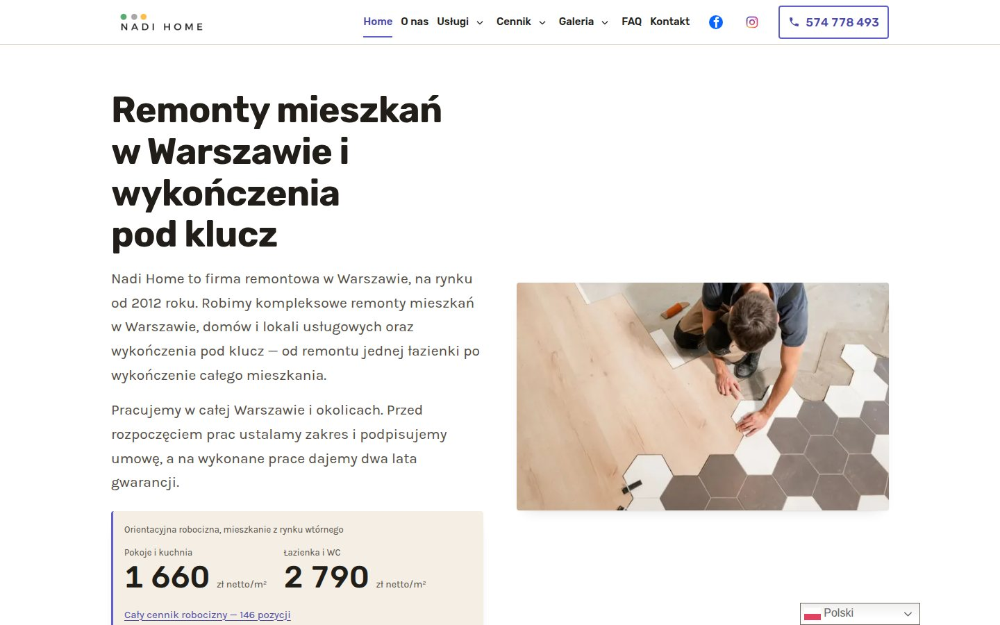

Termin budowy strony podajemy po rozmowie o zakresie: liczbie podstron, formularzach, sklepie i przenoszeniu treści ze starej strony. Najdłużej trwa zwykle zebranie materiałów, czyli tekstów, zdjęć i danych firmy. Samą pracę dzielimy na sześć kroków, od ustalenia zakresu do utrzymania. Niżej opisujemy każdy z nich i to, co dostajesz na końcu.

## Od czego zależy termin?

Na termin wpływają cztery rzeczy. Pierwsza to liczba podstron. Druga to formularze i to, dokąd mają trafiać wiadomości. Trzecia to sklep, jeśli strona ma sprzedawać. Czwarta to stara strona: jej treści, zdjęcia i adresy trzeba przenieść.

Najwięcej czasu zajmuje jednak zwykle coś innego niż programowanie. To zebranie materiałów: opisu usług, zdjęć, logo i danych firmy. Dlatego im szybciej je dostaniemy, tym szybciej strona będzie gotowa. Teksty możemy napisać na podstawie Twoich informacji.

## Jak wygląda praca krok po kroku?

Każda strona przechodzi przez te same etapy:

1. **Zakres.** Ustalamy, co strona ma robić: jakie usługi pokazuje, czy przyjmuje zapytania, czy sprzedaje. Z tego wynika wybór hostingu i panelu.
2. **Treść i zdjęcia.** Teksty i zdjęcia bierzemy od Ciebie albo z obecnej strony. Na stronę trafiają prawdziwe zdjęcia realizacji, nie obrazy z generatora.
3. **Budowa pod adresem roboczym.** Nowa strona powstaje obok starej. Oglądasz ją pod osobnym adresem, zanim zastąpi obecną.
4. **Kontrola przed publikacją.** Automatyczna bramka sprawdza tytuły, opisy, mapę strony, dostępność i wagę plików.
5. **Przepięcie domeny.** Przełączamy domenę na nową stronę, a stare adresy przekierowujemy na nowe.
6. **Utrzymanie.** Po publikacji wprowadzamy zmiany, mierzymy szybkość i pilnujemy Search Console.

Krótszy opis tych kroków jest w sekcji [jak pracujemy przy budowie strony](/#oferta), a dłuższy, razem z technologią, panelem i hostingiem, na stronie [tworzenie strony internetowej krok po kroku](/strony-internetowe-warszawa/).

## Dlaczego nowa strona powstaje obok starej?

Twoja obecna strona działa przez cały czas budowy i klienci nadal ją widzą. Nową wersję oglądasz pod osobnym adresem roboczym i zgłaszasz do niej uwagi.

Dopiero gotowa i sprawdzona strona zastępuje starą. Przy przepięciu domeny stare adresy przekierowujemy na odpowiadające im nowe przekierowaniem 301 po stronie serwera. Dzięki temu działają dawne linki, a wyniki w Google nie prowadzą w próżnię. Po przełączeniu zgłaszamy nową mapę strony w Search Console.

Osobno pilnujemy poczty, bo przy przepinaniu domeny najłatwiej zepsuć właśnie ją. Rekordy pocztowe zostają bez zmian, a pracę uznajemy za skończoną, gdy list testowy dochodzi w obie strony.

## Co sprawdza kontrola przed publikacją?

Zanim strona trafi na hosting, sprawdza ją automatyczna bramka. Patrzy na tytuły i opisy dla wyszukiwarek, mapę strony, dostępność i wagę plików. Strona z błędem nie idzie na hosting.

Bramka nie zastępuje oka: po publikacji każdą zmianę sprawdzamy jeszcze na żywej stronie. Wynik szybkości sprawdzamy dodatkowo pomiarem PageSpeed Insights po publikacji. Strona [Studio Agat](https://studioagat.pl/) po przepisaniu z WordPressa na Astro ma w nim 98–100 punktów.

## Co dostajesz po publikacji?

Strony klientów nie dzielą kodu ani dostępów. Dostajesz:

- osobne repozytorium kodu: każdą wersję strony da się odtworzyć,
- osobną przestrzeń na hostingu z własną wersją PHP,
- panel do edycji treści z dostępem tylko do Twojej strony,
- szyfrowane połączenie (HTTPS) na Twojej domenie,
- mapę strony zgłoszoną w Google Search Console i przez IndexNow do Bing,
- pomiar PageSpeed Insights po publikacji.

Każda zmiana, także z panelu, jest w repozytorium osobnym wpisem, który da się cofnąć. Hosting lh.pl robi dodatkowo codzienną kopię plików i baz danych. Więcej o kopiach jest w odpowiedzi na pytanie [gdzie jest kod strony i co z kopiami](/faq/#kod-i-kopie).

## Co dzieje się po publikacji?

Publikacja nie kończy współpracy. W ramach utrzymania wprowadzamy zmiany, mierzymy szybkość i pilnujemy Search Console. Każda zmiana jest od razu publikowana i sprawdzana na żywej stronie.

Pozycji w wynikach Google nie obiecujemy. Sprawdzamy je pomiarem fraz i poprawiamy stronę na podstawie danych z Search Console. Jeśli firma ma wizytówkę w Google, możemy też prowadzić Profil Firmy: usługi, zdjęcia i wpisy.

Strony, które zbudowaliśmy w ten sposób, znajdziesz w sekcji [nasze realizacje](/#realizacje). Odpowiedzi na inne pytania o czas i zakres są na stronie [pytania o strony i sklepy](/faq/). Jeśli chcesz poznać termin dla swojej strony, [opisz nam, czego potrzebujesz](/#kontakt).

I jeszcze jedno, jeśli oprócz strony urządzasz mieszkanie. Przy kompleksowym projekcie mieszkania współpracujemy ze [Studio Agat](https://studioagat.pl/projektowanie-wnetrz), a jeśli potrzebujesz kompletu mebli na wymiar do całego mieszkania, zapraszamy na stronę [Pan Stolarz](https://pan-stolarz.pl/meble-na-wymiar).
