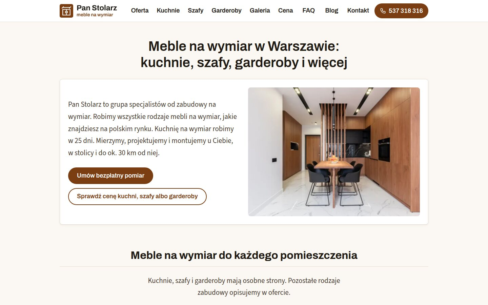

Zacznij od jednego pytania: co strona ma robić. Jeśli ma pokazać usługi i zebrać zapytania od klientów, potrzebujesz strony firmowej. Jeśli klient ma wybrać produkt i zapłacić od razu na stronie, potrzebujesz sklepu internetowego. Od tej odpowiedzi zależy wybór hostingu, panelu do edycji treści i sposób obsługi zamówień. Niżej opisujemy, jak to rozstrzygamy z klientem.

## Co ma robić Twoja strona?

Każdą pracę zaczynamy od ustalenia zakresu. Pytamy, jakie usługi strona pokazuje, czy przyjmuje zapytania i czy sprzedaje. To trzy różne zadania i każde pociąga za sobą inne decyzje techniczne.

Strona, która tylko przedstawia firmę, może być prosta i bardzo lekka. Strona z formularzem potrzebuje serwera, który przyjmie wiadomość i wyśle ją na Twój adres. Strona, która sprzedaje, potrzebuje koszyka, płatności i miejsca, w którym obsłużysz zamówienia.

Na pierwszą rozmowę wystarczy, że napiszesz, jaki adres ma mieć strona, co ma robić i czy masz już domenę, teksty i zdjęcia.

## Kiedy wystarczy strona firmowa?

Strona firmowa wystarczy, gdy klient najpierw pyta, a dopiero potem kupuje. Tak działają nasze realizacje dla firm od remontów, mebli na wymiar i projektów wnętrz. Klient ogląda ofertę i zdjęcia, a potem pisze albo dzwoni.

Taka strona ma u nas zwykle ofertę, galerię realizacji, blog i formularz kontaktowy. Budujemy ją w Astro jako gotowe pliki, więc otwiera się szybko także na telefonie. Formularz w PHP wysyła wiadomość na Twój adres, a boty zatrzymuje Cloudflare Turnstile, bez przepisywania liter z obrazka.

Przykład firmy, która pokazuje usługi i zbiera zapytania, to [Pan Stolarz](https://pan-stolarz.pl/): meble na wymiar w Warszawie, z kalkulatorem ceny i formularzem.

Strona firmowa może też pomóc klientowi oszacować koszt, zanim zapyta. Strony Pan Stolarz, Kuchnia na wymiar Warszawa, Szafy na wymiar Warszawa i Garderoba na wymiar Warszawa mają kalkulatory cen, a żadna z nich nie jest sklepem. Klient sprawdza orientacyjną cenę i wysyła zapytanie.

Więcej przykładów jest w sekcji [realizacje stron i sklepów](/#realizacje).

## Kiedy potrzebny jest sklep internetowy?

Sklep jest potrzebny, gdy klient ma kupić bez rozmowy z Tobą: wybrać produkt, dodać go do koszyka i zapłacić. Wtedy strona musi przyjąć płatność, zapisać zamówienie i przekazać je do obsługi.

Sklep to także praca po Twojej stronie. W sklepie na WooCommerce albo PrestaShop to Ty dodajesz produkty, obsługujesz zamówienia i magazyn. Dlatego przed wyborem drogi pytamy o liczbę produktów i o to, jak będziesz obsługiwać zamówienia.

## Która droga sklepu pasuje do Twojej firmy?

Mamy trzy drogi i wybieramy jedną po rozmowie. Każda pasuje do innej skali sprzedaży.

1. **WooCommerce albo PrestaShop na hostingu** — gdy sam prowadzisz sklep: dodajesz produkty, obsługujesz zamówienia i magazyn.
2. **Katalog w Astro z płatnością przez Stripe Checkout** — gdy produktów jest kilkanaście lub kilkadziesiąt i nie potrzebujesz panelu sklepu.
3. **Katalog w Astro z własnym koszykiem w PHP** — gdy chcesz polskiego operatora płatności z BLIK-iem.

Pierwsza droga daje pełny panel sklepu, ale wymaga obsługi. Druga pasuje do krótkiej oferty bez panelu sklepu. Trzecia łączy szybki katalog w Astro z płatnością BLIK-iem przez polskiego operatora. Przy każdym sklepie bazę zamówień kopiujemy także poza hosting. Szczegóły są w odpowiedzi na pytanie [jaki sklep internetowy możemy zrobić](/faq/#sklep).

## Gdzie stanie strona albo sklep?

Strona z formularzem, sprzedażą albo rezerwacjami stoi na hostingu lh.pl. Każda dostaje osobną przestrzeń z oddzielonym katalogiem i własną wersją PHP, więc nie dzieli miejsca z innymi stronami. Stronę buduje GitHub Actions, a na hosting trafiają gotowe pliki.

Prosta wizytówka bez sprzedaży, rezerwacji i płatności może stać na GitHub Pages bez opłat za hosting. Tak działa ta strona. Repozytorium strony jest wtedy publiczne, więc publiczna jest też historia jej zmian.

Domena zostaje u Twojego rejestratora. Przy przepięciu przenosimy rekordy DNS tak, żeby poczta działała dalej.

## Co przygotować przed pierwszą rozmową?

Nie musisz znać odpowiedzi na wszystkie pytania techniczne. Wystarczy kilka informacji:

1. Jaki adres ma mieć strona i czy masz już domenę.
2. Co strona ma robić: pokazywać usługi, przyjmować zapytania czy sprzedawać.
3. Przy sklepie: ile masz produktów i kto będzie obsługiwał zamówienia.
4. Czy masz teksty, logo i zdjęcia, czy mamy je przygotować.

Na stronę wstawiamy wyłącznie prawdziwe fotografie, Twoje albo z banku zdjęć, a nie obrazy wygenerowane przez AI. Teksty możemy napisać na podstawie Twoich informacji.

Z tych odpowiedzi proponujemy hosting, panel i zakres prac. Cały zakres usług opisuje [oferta budowy stron i sklepów](/#oferta). Gdy wiesz już, czego potrzebujesz, [napisz albo zadzwoń do nas](/#kontakt).

A jeśli poza stroną urządzasz też mieszkanie: przy kompleksowym projekcie mieszkania współpracujemy ze [Studio Agat](https://studioagat.pl/projektowanie-wnetrz), a po komplet mebli na wymiar do całego mieszkania zapraszamy na stronę [Pan Stolarz](https://pan-stolarz.pl/meble-na-wymiar).
