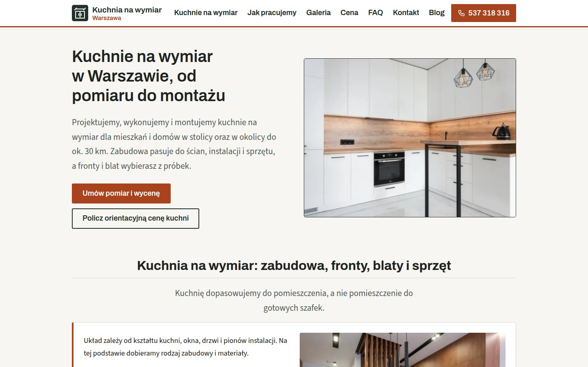
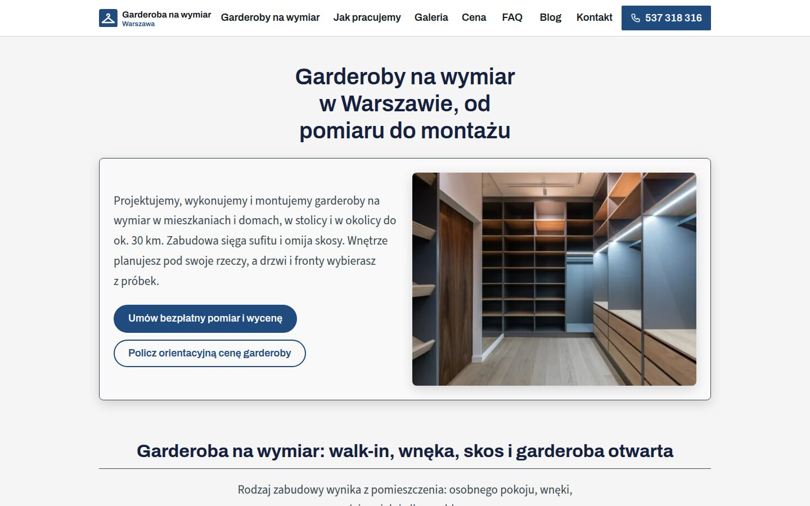
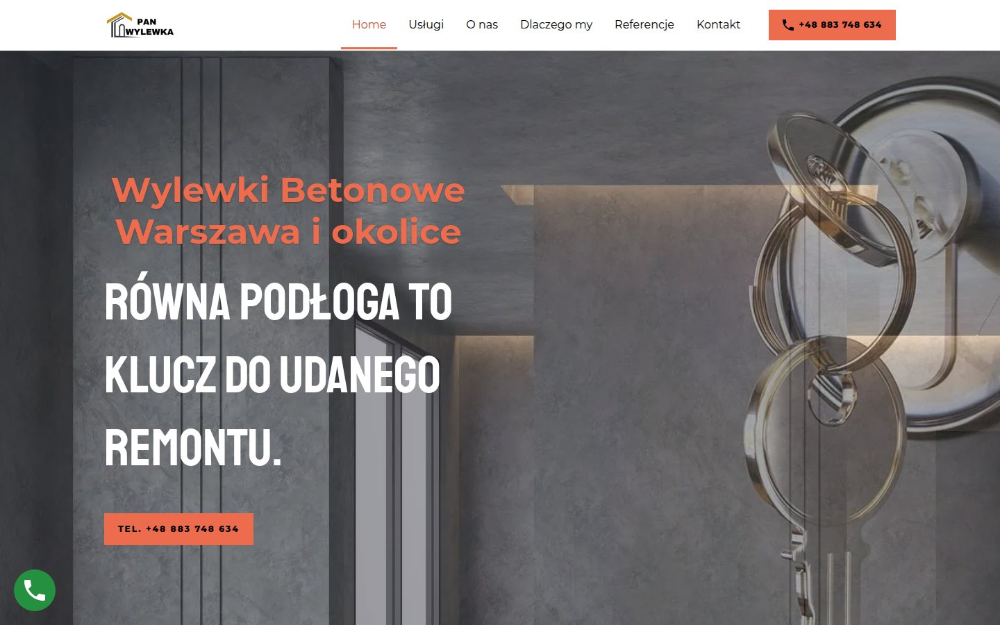

Strona wizytówka to jedna strona albo dwie, trzy podstrony, które mówią, kim jesteś, co robisz, gdzie działasz i jak się z Tobą skontaktować. Musi mieć krótką ofertę, dane kontaktowe, formularz, prawdziwe zdjęcia oraz tytuł i opis dla Google. Niżej pokazujemy każdy z tych elementów na przykładach z naszych stron i piszemy, kiedy wizytówka przestaje wystarczać.

## Czym jest strona wizytówka?

W naszym cenniku wizytówka to jedna strona albo dwie, trzy podstrony z formularzem kontaktowym. Strona firmowa ma zwykle od pięciu do dziesięciu podstron, panel do edycji treści, formularz i podstawowe SEO. Wizytówka nic nie sprzedaje, nie przyjmuje rezerwacji ani płatności.

Jej zadanie jest proste. Klient usłyszał o firmie albo zobaczył ją w Mapach Google. Wchodzi na stronę, sprawdza, czy robisz to, czego szuka, i pisze albo dzwoni. Wszystko, co mu w tym przeszkadza, jest na wizytówce zbędne.

Co zawiera nasza wizytówka i dla kogo ją robimy, opisujemy na stronie [strona wizytówka dla firmy](/strona-wizytowka/).

## Co musi zawierać strona wizytówka?

Tę listę sprawdzamy przy każdej małej stronie, zanim pokażemy ją klientowi:

1. **Nagłówek, który mówi, co robisz i gdzie.** Klient ma to zrozumieć w pierwszej sekundzie, bez przewijania.
2. **Krótka oferta.** Lista usług, przy każdej jedno albo dwa zdania. Bez ogólników o pasji i jakości.
3. **Jeden główny przycisk.** Na przykład „Umów pomiar i wycenę” albo „Zadzwoń”, wyróżniony kolorem. Drugi przycisk, jeśli jest, wygląda skromniej, żeby klient wiedział, od czego zacząć.
4. **Dane kontaktowe.** Nazwa firmy, adres, telefon i e-mail, wszędzie zapisane tak samo jak w wizytówce Google.
5. **Formularz kontaktowy chroniony przed spamem.** Boty zatrzymuje Cloudflare Turnstile, bez przepisywania liter z obrazka.
6. **Prawdziwe zdjęcia.** Twoje realizacje albo fotografie z banku zdjęć. Obrazów wygenerowanych przez AI na strony nie wstawiamy.
7. **Tytuł i opis dla Google.** Do tego dane firmy w danych strukturalnych i mapa strony zgłoszona w Google Search Console oraz w Bing przez IndexNow.
8. **Polityka prywatności.** Formularz zbiera dane, więc polityka mówi, kto jest administratorem danych i dokąd trafia zgłoszenie.

Do tego dochodzi szyfrowane połączenie (HTTPS) na Twojej domenie. Każdą stronę mierzymy też po publikacji w Google PageSpeed Insights, osobno na telefonie i na komputerze.

## Jak wyglądają przykłady stron wizytówek?

Pokazujemy trzy nasze strony o meblach na wymiar. Uczciwie: każda z nich ma więcej niż wizytówka, bo do oferty i kontaktu dochodzą kalkulator ceny, galeria, FAQ i blog. Ich pierwszy ekran pokazuje jednak dokładnie to, od czego zaczyna się dobra wizytówka.

- **Kuchnia na wymiar Warszawa.** Tytuł „Kuchnie na wymiar w Warszawie, od pomiaru do montażu”, obok zdjęcie białej kuchni z drewnianym blatem. Pod tytułem wyróżniony przycisk „Umów pomiar i wycenę”, a niżej skromniejszy „Policz orientacyjną cenę kuchni”.
- **Szafy na wymiar Warszawa.** Granatowy pas z tytułem „Szafy na wymiar w Warszawie: wnękowe, przesuwne i do sufitu”, zdjęcie sypialni z szafą i mosiężny przycisk pomiaru. Drugi przycisk prowadzi do kalkulatora ceny szafy.
- **Garderoba na wymiar Warszawa.** Jasne, szałwiowe tło i wyśrodkowany tytuł „Garderoby na wymiar w Warszawie, od pomiaru do montażu”. Pod nim dwa przyciski, pomiar i cena, a niżej duże zdjęcie garderoby.

Każda ma własną kolorystykę, żeby nie wyglądały jak kopie jednej strony. W pomiarze PageSpeed Insights z 27 października 2026 roku dostały na telefonie od 99 do 100 punktów za wydajność. Wszystkie nasze strony z wynikami pomiarów są w sekcji [nasze realizacje](/#realizacje).

## Ile podstron potrzebuje wizytówka?

Jedna strona wystarczy, gdy masz jedną usługę albo kilka blisko związanych. Klient przewija ją od oferty, przez zdjęcia, do kontaktu, a menu przenosi go do wybranej sekcji.

Dwie albo trzy podstrony mają sens, gdy chcesz osobno pokazać ofertę, realizacje i kontakt. Każda podstrona ma wtedy własny tytuł i opis, a Google pokazuje ją w wynikach osobno. Zasada, której się trzymamy: jedna podstrona odpowiada na jedną sprawę, o którą pytają klienci.

## Gdzie może stać strona wizytówka?

Wizytówka bez sprzedaży, rezerwacji i płatności może stać na GitHub Pages bez opłat za hosting. Tak działa strona, którą czytasz. Repozytorium strony jest wtedy publiczne, więc publiczna jest też historia jej zmian. Sama treść i tak ma być widoczna dla wszystkich.

GitHub Pages nie uruchamia PHP. Dlatego formularz takiej strony obsługuje skrypt na osobnym hostingu. Tak działa formularz kontaktowy tej strony: wysyła zgłoszenie do skryptu PHP na hostingu lh.pl.

Strona, która sprzedaje albo przyjmuje rezerwacje, stoi u nas na hostingu lh.pl. Każda dostaje tam osobną przestrzeń z oddzielonym katalogiem i własną wersją PHP. Domena zostaje u Twojego rejestratora. Przy przepięciu przenosimy rekordy DNS tak, żeby poczta działała dalej.

## Czy wizytówka Google wystarczy zamiast strony?

Profil Firmy w Google i strona nie konkurują ze sobą. Mają się wzajemnie potwierdzać. W profilu ustawiamy adres strony, a na stronie te same dane: nazwę, adres i telefon, w stopce, na stronie kontaktu i w danych strukturalnych z odnośnikiem do mapy.

Strona mówi więcej niż profil. Mieści pełną ofertę, odpowiedzi na pytania klientów i zdjęcia z opisem tego, co na nich widać. Wpisy w profilu mogą prowadzić do podstron usług, więc klient z Map trafia od razu na właściwą ofertę. Jeśli nie chcesz pilnować obu miejsc sam, [prowadzimy wizytówkę Google razem ze stroną](/prowadzenie-strony-internetowej/).

## Kiedy wizytówka przestaje wystarczać?

Wizytówka jest dobrym początkiem, ale są cztery sytuacje, w których proponujemy więcej:

1. **Masz kilka usług, a każdej klienci szukają innymi słowami.** Wtedy każda usługa potrzebuje własnej podstrony z własnym tytułem. To już strona firmowa, a jej budowę opisujemy na stronie [tworzenie stron internetowych dla firm](/strony-internetowe-warszawa/).
2. **Chcesz często zmieniać treść albo prowadzić blog.** Strona firmowa ma u nas panel do edycji treści pod adresem /admin/.
3. **Klient ma poznać koszt przed rozmową.** Pomaga kalkulator ceny, taki jak na naszych stronach o meblach na wymiar.
4. **Chcesz sprzedawać albo przyjmować płatności.** Wtedy potrzebny jest sklep. Jak wybrać, piszemy we wpisie [strona czy sklep internetowy](/blog/strona-czy-sklep-internetowy-od-czego-zaczac/).

## Ile kosztuje wizytówka i od czego zacząć?

Cena wizytówki jest w cenniku. Możesz ją też [policzyć w kalkulatorze](/cena/#kalkulator) razem z hostingiem, domeną i opieką po publikacji. Wyliczenie dodasz jednym przyciskiem do formularza.

Na początek wystarczy kilka informacji: jaki adres ma mieć strona, czym zajmuje się firma i czy masz już domenę, teksty i zdjęcia. Teksty możemy napisać na podstawie Twoich informacji. Gdy wiesz, czego potrzebujesz, [zapytaj o wycenę strony wizytówki](/kontakt/).
