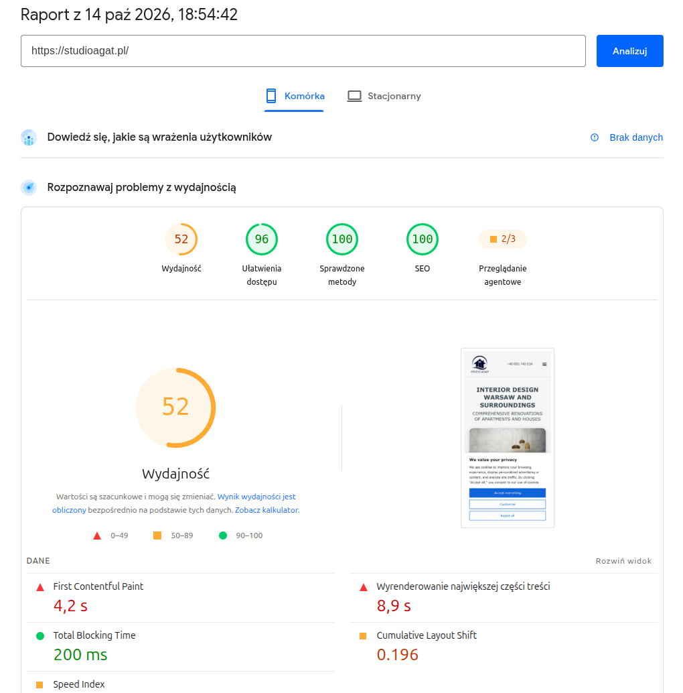
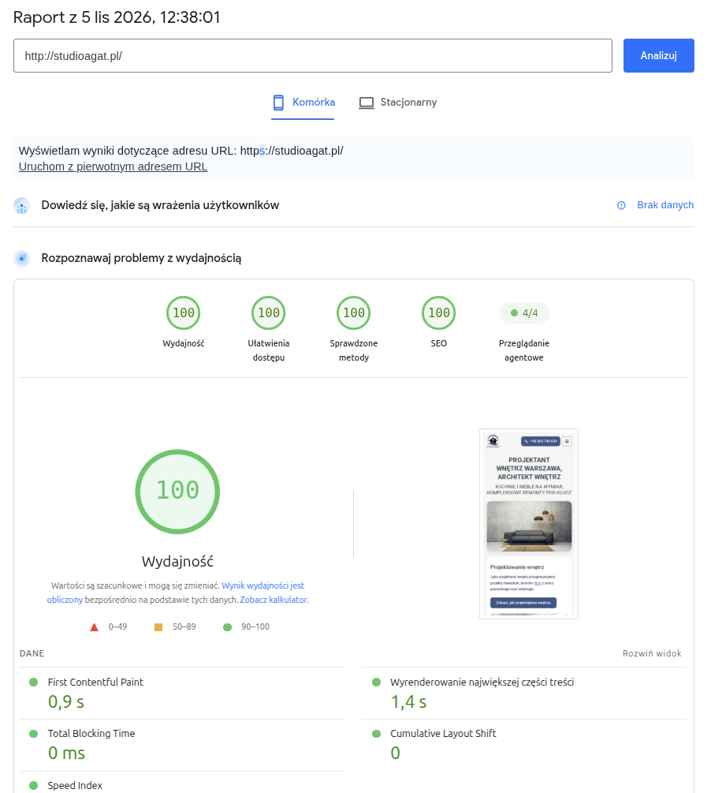
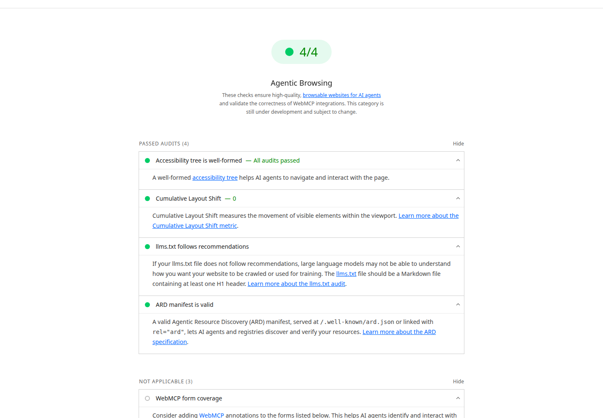

Wyszukiwanie agentowe to wyszukiwanie, w którym asystent AI sam wykonuje zadanie: szuka terminu, porównuje oferty, wypełnia formularz. Dla strony i sklepu oznacza to trzy osobne sprawy. Czy AI Search Twoją stronę znajdzie i pokaże. Czy agent w przeglądarce ją obsłuży. Czy sklep sprzeda przez protokół zakupowy. Pierwszą załatwia zwykłe SEO, drugą dostępny HTML, a trzecia na razie dotyczy głównie USA.

<span class="dowod dowod--dokumentacja">Dokumentacja</span> To trzy różne rzeczy, każda z własnymi zaleceniami. Pliki i manifesty dla agentów, takie jak llms.txt czy manifest ARD, nie podnoszą pozycji w odpowiedziach AI. Google pisze, że do AI Overviews i AI Mode nie trzeba tworzyć nowych plików maszynowych, plików tekstowych dla AI ani znaczników (11).

## Agent wykonuje zadanie, zamiast pokazywać listę linków

W zwykłym wyszukiwaniu dostajesz listę stron i sam klikasz. Agent dostaje zadanie, na przykład „znajdź stolik na czwartek na 19:00”, sam przechodzi przez strony i wraca z wynikiem albo formularzem do zatwierdzenia. Hasło [Wyszukiwanie agentowe](https://pl.wikipedia.org/wiki/Wyszukiwanie_agentowe) w polskiej Wikipedii napisaliśmy i dodaliśmy sami, 5 listopada 2026, jako krótkie wyjaśnienie tego pojęcia.

Najdalej zaszedł Google AI Mode:

- **Sierpień 2025.** Start od rezerwacji stolików dla subskrybentów AI Ultra w USA. AI Mode pokazuje wolne terminy z wielu platform i prowadzi na stronę rezerwacji, gdzie kończy człowiek. Partnerami są między innymi OpenTable, Resy i Tock (1). Pod spodem działa przeglądanie Project Mariner oraz dane Knowledge Graph i Map Google (2).
- **Listopad 2025.** W Google Labs w USA doszły bilety na wydarzenia i wizyty w salonach urody, dla subskrybentów AI Pro i Ultra. Transakcję nadal kończyło się na stronie dostawcy (21).
- **Kwiecień 2026.** Rezerwacja stolików działa w AI Mode bez zapisu do Labs. Objęła osiem nowych rynków: Australię, Kanadę, Hongkong, Indie, Nową Zelandię, Singapur, RPA i Wielką Brytanię (20).
- **Maj 2026.** Google zapowiedział na lato, w USA, rezerwacje usług lokalnych, na przykład napraw domowych, urody i opieki nad zwierzętami. Rezerwację kończy się u wybranego dostawcy. Zapowiedział też telefon do firmy w imieniu użytkownika (22).
- **Sierpień 2026.** Pierwszy wyjątek od zasady „kończysz u dostawcy”. Od 27 sierpnia w USA, po angielsku, rezerwację hotelu można dokończyć w Google: przyciskiem „Continue on Google” i płatnością Google Pay. Sprzedawcą pozostaje hotel albo platforma rezerwacyjna i to ona obsługuje klienta (23).

Polski żadne z tych źródeł nie wymienia.

Pozostali gracze:

- **ChatGPT agent (OpenAI).** Od 17 lipca 2025 łączy klikanie po stronach z Operatora i zbieranie wiedzy z Deep Research. OpenAI wyłączyło agentowi pamięć z obawy przed wykradaniem danych przez prompt injection (4).
- **Perplexity Comet.** Przeglądarka z agentem w panelu bocznym. W teście TechCrunch agent przy rezerwacji parkingu wpisał błędne daty (5).
- **Claude in Chrome (Anthropic).** Agent w Chrome, od sierpnia 2025 w pilotażu dla 1000 użytkowników planu Max (6).

TechCrunch ocenia działanie agentów w realnym świecie jako kruche (4).


## Cel pierwszy: widoczność w AI Search stoi na zwykłym SEO

Pierwszy cel to obecność w odpowiedziach: w AI Overviews i AI Mode Google oraz w ChatGPT Search. Google podaje wprost, że funkcje AI w wyszukiwarce nie mają dodatkowych wymagań technicznych. Strona ma być zindeksowana i kwalifikować się do fragmentu w wynikach, a dane strukturalne mają zgadzać się z widocznym tekstem (11).

Nasze strony wysyłają gotowy HTML z Astro, więc tekst jest w kodzie od razu. <span class="dowod dowod--badanie">Badanie</span> Praca o GEO, czyli optymalizacji pod silniki generatywne, pokazała do 40 % większą widoczność w ich odpowiedziach (17). To wynik badania, nie gwarancja dla Twojej strony. Skuteczność metod zależała tam od dziedziny (17).

### Znaleźć, wybrać, zacytować: trzy progi, które strona przechodzi osobno

<span class="dowod dowod--ocena">Ocena autora</span> Asystent AI najpierw zbiera strony, które pasują do pytania. Potem wybiera z nich fragmenty, na których oprze odpowiedź. Na końcu decyduje, które źródła pokaże jako link. Strona może przejść pierwszy próg i odpaść na drugim.

<figure class="lejek"><figcaption class="lejek__tytul">Trzy progi strony w odpowiedzi asystenta AI</figcaption><ol class="lejek__progi"><li class="lejek__prog"><span class="lejek__nazwa">Znaleziona</span><span class="lejek__opis">trafia do zbioru stron pasujących do pytania</span></li><li class="lejek__prog"><span class="lejek__nazwa">Wybrana</span><span class="lejek__opis">jej fragment staje się podstawą odpowiedzi</span></li><li class="lejek__prog"><span class="lejek__nazwa">Zacytowana</span><span class="lejek__opis">asystent pokazuje ją jako link</span></li></ol></figure>

Na pierwszy próg wpływasz technicznie: strona otwiera się bez błędu, robot czyta tekst bez uruchamiania skryptów, a dane firmy stoją w danych strukturalnych. Drugi zależy od treści: czy akapit sam odpowiada na pytanie i czy jego pierwsze zdanie nazywa rzecz pełną nazwą. Trzeciego nie kontroluje nikt poza dostawcą asystenta. Nasze strony mierzę na pierwszym progu, bo tylko ten da się sprawdzić powtarzalnie: w PageSpeed Insights i w kategorii przeglądania agentowego Lighthouse.

### Asystent zadaje kilka pytań naraz

<span class="dowod dowod--dokumentacja">Dokumentacja</span> AI Overviews i AI Mode mogą rozbić pytanie na kilka węższych wyszukiwań, po podtematach, i z ich wyników złożyć jedną odpowiedź. Google nazywa tę technikę „query fan-out” (11).

<figure class="schemat"><figcaption class="schemat__tytul">Jak asystent AI składa odpowiedź</figcaption><ol class="schemat__kroki"><li class="schemat__krok">Pytanie klienta</li><li class="schemat__krok">Zapytania pomocnicze</li><li class="schemat__krok">Pasujące strony</li><li class="schemat__krok">Wybrane fragmenty</li><li class="schemat__krok">Odpowiedź z linkami</li></ol></figure>

<span class="dowod dowod--ocena">Ocena autora</span> Kto pyta o stronę dla stolarza w Warszawie, ten pośrednio pyta też o cenę, czas budowy, hosting i panel do zmian. Strona, która odpowiada na każde z tych pytań w osobnej, jasno nazwanej sekcji, ma więcej okazji, żeby trafić do odpowiedzi. Dlatego nasze strony usług mają osobne sekcje o cenie, czasie, hostingu i panelu. Nie robimy dziesięciu cienkich podstron pod odmiany jednej frazy.

### Dane strukturalne mają trzy poziomy pewności

JSON-LD opisuje firmę, usługę albo produkt słownikiem schema.org. Pewność użycia zależy od odbiorcy:

1. **Pewne: wyszukiwarka.** Google czyta dane strukturalne i wymaga, żeby zgadzały się z widocznym tekstem. Do AI Overviews i AI Mode nie trzeba przy tym specjalnych typów (11).
2. **Możliwe: niektóre systemy AI.** Na schema.org opiera się NLWeb, otwarty projekt Microsoftu. Każda jego instancja działa jako serwer MCP (Model Context Protocol), czyli źródło narzędzi dla modelu AI (15).
3. **Bez gwarancji: agent w przeglądarce.** Nie znalazłem dokumentu Google ani Bing, który mówi, że agent przeglądarkowy czyta JSON-LD.

Dlatego nie dokładamy typów ani ofert na wyrost. Service z ofertą wpisujemy tylko przy usłudze, którą firma naprawdę świadczy i która jest opisana na stronie.

### llms.txt to dodatkowy indeks, nie sygnał rankingowy

llms.txt to propozycja Jeremy’ego Howarda z Answer.AI z 3 września 2024 (12). To plik Markdown w katalogu głównym: obowiązkowy jest tylko nagłówek H1, dalej podsumowanie w cytacie i sekcje z linkami (12). To propozycja, nie standard.

Może być użytecznym dodatkowym indeksem treści dla systemów, które go obsługują. Nie ma potwierdzonego wpływu na widoczność w Google ani w ChatGPT. Dokumentacja Google nie wymienia go z nazwy, mówi ogólnie, że plików dla AI nie trzeba (11). Wprost wypowiadał się John Mueller z Google, ale jako osoba, nie w dokumentacji. W czerwcu 2025 napisał, że według niego żaden system AI nie używa llms.txt i widać to w logach serwera (24). W 2026 nazwał plik na razie czysto spekulacyjnym i dodał, że podoba mu się podejście WebMCP (25).

Lighthouse sprawdza llms.txt w kategorii przeglądania agentowego (10). Audyt patrzy na formę pliku, nie na treść, i nie jest sygnałem rankingowym. Skaner Cloudflare domyślnie llms.txt pomija (7). My plik mamy, bo mierzymy tę kategorię Lighthouse.

### Content-Signal to deklaracja preferencji, nie blokada

Content-Signal to wiersz w robots.txt, który Cloudflare opisał we wrześniu 2025. Mówi, do czego wolno użyć treści strony (8):

- `search`: indeks i wyniki z linkami i fragmentami,
- `ai-input`: użycie treści w odpowiedzi AI na bieżące pytanie,
- `ai-train`: trenowanie i dostrajanie modeli.

Cloudflare wpisuje go w zarządzanym robots.txt ponad 3,8 mln domen (8). Sam Cloudflare pisze jednak, że sygnały wyrażają preferencje i nie są technicznym zabezpieczeniem przed pobieraniem treści. Niektóre firmy mogą je zignorować, więc radzi łączyć je z regułami WAF i zarządzaniem botami (8). Tekst polityki traktuje ograniczenia z sygnałów jako wyraźne zastrzeżenie praw na podstawie art. 4 dyrektywy o prawie autorskim (8). Ma więc wagę deklaracji z zastrzeżeniem praw, ale bota technicznie nie zatrzyma.

U nas grupa dla bota OpenAI wygląda tak:

```text
User-agent: GPTBot
Allow: /
Disallow: /admin/
Content-Signal: search=yes, ai-input=yes, ai-train=yes
```

Wiersz Content-Signal stawiam pod każdą grupą User-agent. Bot z własną grupą czyta tylko ją, więc sygnał w samej grupie ogólnej by do niego nie dotarł. Token Google-Extended ogranicza z kolei użycie treści do trenowania modeli Google (11).

Szkic Web Bot Auth Thibaulta Meuniera (Cloudflare) i Sandora Majora (Google) proponuje, żeby bot podpisywał żądania HTTP, a serwer sprawdzał podpis. To indywidualny szkic IETF, nie standard (14).

### Boty AI pobierają dużo, a odsyłają mało

<span class="dowod dowod--badanie">Badanie</span> Cloudflare Radar policzył ruch od 1 stycznia do 2 grudnia 2025 (9). Boty AI dały średnio 4,2 % żądań o strony HTML. Googlebot dał 4,5 %, a ludzie 47 % (9).

Na jedno kliknięcie, które wraca do witryny, bot Anthropic pobierał do 500 000 stron, bot OpenAI najwyżej 3 700, Perplexity od września 2025 poniżej 200 (9).

### Zalecenia dla widoczności w AI Search

1. **Indeksowanie i jakość jak w zwykłym SEO.** Strona zindeksowana, tekst w HTML, treść odpowiadająca na pytania klientów (11).
2. **Dane strukturalne zgodne z widoczną treścią.** Organization albo LocalBusiness dla firmy, Service tylko przy usłudze świadczonej i opisanej, Product z Offer w sklepie (11).
3. **Decyzja o botach AI w robots.txt.** Content-Signal z trzema sygnałami pod każdą grupą User-agent (8). To deklaracja; zatrzymać bota może dopiero reguła po stronie serwera (8).
4. **llms.txt opcjonalnie.** Jako dodatkowy indeks treści, bez oczekiwania wzrostu pozycji (12, 24, 25).

## Cel drugi: agent w przeglądarce potrzebuje dostępnej strony

Agent przeglądarkowy, taki jak Comet czy Claude in Chrome, działa w zwykłej przeglądarce, jak człowiek (5, 6). Liczy się, czy elementy mają nazwy, czy stoją w miejscu i czy formularz da się wysłać.

### Drzewo dostępności i etykiety prowadzą agenta

Drzewo dostępności to uproszczona mapa strony, którą buduje przeglądarka. Każdy przycisk, pole i link ma w niej rolę i nazwę. Lighthouse w kategorii przeglądania agentowego sprawdza te nazwy i etykiety, poprawność drzewa i widoczność elementów (10). Guzik bez nazwy albo pole bez etykiety to dla agenta zagadka.

### Stabilny układ znaczy CLS do 0,1, nie zero

<span class="dowod dowod--dokumentacja">Dokumentacja</span> Lighthouse liczy do tej kategorii Cumulative Layout Shift, czyli przesunięcia elementów podczas ładowania (10). Dobry wynik według web.dev to CLS 0,1 lub mniej. Mierzy się go na 75. percentylu wczytań strony, osobno na telefonach i komputerach (28). Próg dotyczy danych terenowych od użytkowników. Nasze CLS równe 0 to pomiar laboratoryjny z jednego przebiegu, nie wymóg.

### Formularz ma być dostępny i działać, z JavaScriptem czy bez

Skrypty strony wykonują się więc także dla agenta i formularz nie musi działać bez JavaScriptu. Warunek jest inny: każde pole ma etykietę, guzik ma nazwę, a wysyłka działa. Formularze bez JavaScriptu to nasz wybór tam, gdzie się da. Kalkulator wyceny na naszej stronie wysyła się zwykłym HTML. Formularz kontaktowy ma ochronę przed spamem, która wymaga skryptu, a bez skryptu pokazuje adres e-mail i telefon.

### Czytelna strona nie chroni przed prompt injection

Prompt injection to ukryte polecenie na stronie, które próbuje przejąć agenta. Semantyczny HTML pomaga agentowi działać, ale nie chroni go przed przejęciem.

<span class="dowod dowod--badanie">Badanie</span> Anthropic sprawdził swoje rozszerzenie na 123 przypadkach w 29 scenariuszach ataku. Bez zabezpieczeń atak udawał się w 23,6 % prób, po zabezpieczeniach, w trybie autonomicznym, w 11,2 %. W czterech atakach typowych dla przeglądarki skuteczność spadła z 35,7 % do 0 % (6). Te zabezpieczenia dodał twórca agenta, nie autorzy stron. OpenAI z tego samego powodu wyłączyło pamięć swojemu agentowi (4).

### Zalecenia dla agenta w przeglądarce

1. **Etykiety i nazwy.** Każde pole ma etykietę, każdy guzik i link nazwę. Sprawdzisz to audytem drzewa dostępności w PageSpeed Insights (10).
2. **Stabilny układ.** CLS do 0,1 w danych terenowych (28). W laboratorium sprawdzisz go w PageSpeed Insights, osobno na telefonie i komputerze.
3. **Formularz dostępny i działający.** Wyślij go sam, potem zleć to agentowi i sprawdź, co dotarło.

## Cel trzeci: zakupy przez protokoły agentowe dopiero startują

Trzeci cel to sprzedaż, w której agent rozmawia ze sklepem przez protokół, zamiast klikać. Wszystko jest tu młode.

### UCP i ACP to protokoły zakupowe z USA

11 stycznia 2026 Google ogłosił Universal Commerce Protocol, w skrócie UCP (3). To otwarty standard dla całej drogi zakupu, działający z protokołami A2A, AP2 i MCP. Współtworzyli go Shopify, Etsy, Wayfair, Target i Walmart. Poparło go ponad 20 firm, w tym Visa, Mastercard, Stripe i Zalando (3). Sprzedawcą pozostaje sklep, nie Google. Płatność w AI Mode ma iść przez Google Pay, w USA i „wkrótce” (3).

Wcześniej, 29 września 2025, Stripe i OpenAI pokazali Agentic Commerce Protocol, czyli ACP (16). To także otwarty standard: sprzedawca integruje się raz, a sklep bez Stripe może go wdrożyć z własnym operatorem płatności (16).

Shared Payment Token z ACP działa tylko u jednego sprzedawcy i na kwotę jednego koszyka, bez ujawniania danych karty (16). Na start z ChatGPT kupowali użytkownicy w USA, od sprzedawców z Etsy (16).

### WebMCP udostępnia agentowi narzędzia strony

WebMCP pozwala stronie udostępnić agentom narzędzia napisane w JavaScripcie. To szkic grupy społecznościowej W3C, nie standard (13). Will Huang pokazał w AgentReady.js, jak jeden tag `<script>` zamienia semantyczny HTML w takie narzędzia. Zakup i wysłanie formularza zostawia tam do zatwierdzenia człowiekowi (18).

### ARD jest eksperymentalną propozycją

ARD (Agentic Resource Discovery) to format, w którym strona opisuje swoje zasoby dla agentów, na przykład w pliku `/.well-known/ard.json` (26). Specyfikacja ma wersję 0.91 i status „Proposal”, czyli propozycji; autorzy zastrzegają, że format może się zmienić (26). Podpisują ją Junjie Bu z Google, Shaun Smith z Hugging Face i R.V. Guha. Rozwija ją grupa robocza z udziałem między innymi Microsoftu, Google, Hugging Face i GoDaddy, na licencji Apache 2.0 (26).

W źródłach, które przeczytałem, żaden duży agent nie deklaruje, że czyta ARD. Lighthouse ma audyt manifestu: sprawdza zgodność pliku ze schematem pakietem zgodności ARD v0.91. Brak manifestu nie wpływa na wynik (27). Audyt nie sprawdza, czy ktokolwiek plik czyta.

### Badanie Cloudflare mierzy adopcję, nie skuteczność

W kwietniu 2026 Cloudflare uruchomił ocenę gotowości strony dla agentów w czterech wymiarach: wykrywalność, treść w Markdown, kontrola dostępu botów i możliwości, takie jak katalog API, MCP Server Card i WebMCP (7). Przy okazji przebadał 200 000 najczęściej odwiedzanych domen. Odfiltrował kategorie, w których gotowość na agentów nie ma znaczenia, na przykład przekierowania, serwery reklam i usługi tunelowania (7). Plik robots.txt ma 78 % badanych domen, deklarację preferencji wobec AI 4 % (7). Negocjację Markdown przechodzi 3,9 % stron: serwer na nagłówek `Accept: text/markdown` oddaje Markdown zamiast HTML (7). MCP Server Card i katalog API miało razem mniej niż 15 stron z całej próby, a kontrole handlu agentowego nie liczą się na razie do wyniku (7).

To pomiar adopcji. O ruchu ani o rekomendacjach wpis Cloudflare nie mówi. Mówi o kosztach agenta, liczonych w tokenach, czyli kawałkach tekstu: Markdown może obniżyć zużycie tokenów nawet o 80 % w niektórych przypadkach. Na dokumentacji Cloudflare agent zużył średnio o 31 % mniej tokenów i działał o 66 % szybciej (7).

### Sklep dziś porządkuje dane, protokoły przyjdą później

UCP i ACP wystartowały w USA (3, 16), a Polski żadne ze źródeł nie wymienia.

Dziś liczą się dane produktów w Google Merchant Center: ceny, dostępność i dostawa takie same jak w sklepie. Google dokłada do feedu kilkadziesiąt nowych atrybutów, na przykład pytania i odpowiedzi, akcesoria i zamienniki (3).

### Zalecenia dla zakupów agentowych

1. **Dziś: dane produktów.** Feed w Merchant Center zgodny ze sklepem (3), Product z Offer zgodny z kartą produktu (11).
2. **Później: UCP i ACP.** Obserwuj. Dla Polski źródła nie podają startu (3, 16).
3. **WebMCP: obserwuj.** To szkic, nie standard (13).
4. **ARD: eksperymentalne.** Wdrażaj, gdy masz powód. My mamy, bo mierzymy kategorię przeglądania agentowego w Lighthouse, a ta sprawdza manifest (27).

## Co zmierzyłem: cztery nasze strony, jedna metoda

Mierzę cztery strony, które zbudowaliśmy i prowadzimy: www.ecopowerpolska.pl, studioagat.pl, pan-stolarz.pl i nadihome.pl (19).

### Metoda pomiaru

- **Pomiar główny:** API PageSpeed Insights (Lighthouse na serwerach Google), wersja Lighthouse 13.6.0, 5 listopada 2026 między 12:37:59 a 12:38:01. Każda strona raz na emulowanym telefonie i raz na komputerze, jeden przebieg na wariant.
- **Zrzuty studioagat.pl:** raport PageSpeed Insights w przeglądarce, wariant telefonu, 14 października 2026 o 18:54 i 5 listopada 2026 o 12:38.
- **Sygnały dla agentów:** polecenie `curl`, 5 listopada 2026 około 12:43.
- **Zmienność:** to wyniki laboratoryjne i zmieniają się między przebiegami. W tej samej minucie studioagat.pl dostał 98 na telefonie przez API i 100 w raporcie w przeglądarce.

Surowe pliki JSON z API publikuję w repozytorium [ecopowerpolska/wyszukiwanie-agentowe](https://github.com/ecopowerpolska/wyszukiwanie-agentowe) na GitHubie.

### Studio Agat: dwie wersje jednej strony

<span class="dowod dowod--pomiar">Nasz pomiar</span> 14 października 2026 strona studioagat.pl działała jeszcze na WordPressie. Dwa dni później przenieśliśmy ją na Astro. To porównanie dwóch wersji jednej strony, nie dwóch technologii. Zmieniła się platforma, ale też budowa strony, zasoby i ich optymalizacja. Wolno z niego wyciągnąć tylko tyle, że ta migracja poprawiła wyniki tej strony.

| Wynik testu na telefonie | 14 października 2026, wersja na WordPressie | 5 listopada 2026, wersja w Astro |
|---|---|---|
| Wydajność | 52 | 100 |
| Ułatwienia dostępu | 96 | 100 |
| Sprawdzone metody | 100 | 100 |
| SEO | 100 | 100 |
| Przeglądanie agentowe | 2/3 | 4/4 |
| First Contentful Paint | 4,2 s | 0,9 s |
| Largest Contentful Paint | 8,9 s | 1,4 s |
| Total Blocking Time | 200 ms | 0 ms |
| Cumulative Layout Shift | 0,196 | 0 |





<span class="dowod dowod--ocena">Ocena autora</span> Wiersza „Przeglądanie agentowe” nie da się porównać. W październiku kategoria miała trzy punktowane audyty, dziś ma cztery. Google ją rozbudował, więc 2/3 i 4/4 to dwie różne skale. Zrzut z października nie pokazuje, który audyt wtedy nie przeszedł.

### Cztery strony w jednym pomiarze

| Strona | Wydajność, telefon | Wydajność, komputer | Dostępność | Sprawdzone metody | SEO | Przeglądanie agentowe |
|---|---|---|---|---|---|---|
| www.ecopowerpolska.pl | 99 | 100 | 100 | 100 | 100 | 4/4 |
| studioagat.pl | 98 | 100 | 100 | 100 | 100 | 4/4 |
| pan-stolarz.pl | 99 | 100 | 100 | 100 | 100 | 4/4 |
| nadihome.pl | 99 | 100 | 100 | 100 | 100 | 4/4 |

<span class="dowod dowod--pomiar">Nasz pomiar</span> Na telefonie LCP wyniósł 1,0 s na trzech stronach i 1,4 s na studioagat.pl. TBT wyniósł 0 ms wszędzie poza pan-stolarz.pl na telefonie (10 ms). CLS wyniósł 0, poza nadihome.pl na komputerze (0,001).

### Wynik 4/4 to audyt techniczny, nie widoczność w AI



Do wyniku liczą się cztery audyty (zmierzyłem 5 listopada 2026):

1. **Drzewo dostępności jest poprawne.** Każdy przycisk, pole i link ma rolę i nazwę. Po tym drzewie agent porusza się po stronie i klika.
2. **Cumulative Layout Shift.** Elementy nie przesuwają się podczas ładowania (10).
3. **llms.txt zgodny z zaleceniami.** Plik jest Markdownem i ma co najmniej jeden nagłówek H1. Audyt sprawdza formę pliku, nie jego treść.
4. **Manifest ARD jest poprawny.** Plik `/.well-known/ard.json` albo plik wskazany atrybutem `rel="ard"` zgadza się ze schematem (27).

Trzy audyty WebMCP mają wagę 0 i status „nie dotyczy”, bo WebMCP nie wdrażamy. Google opisuje całą kategorię jako eksperymentalną, wciąż rozwijaną i podatną na zmiany (10).

Lighthouse sprawdza wybrane kryteria techniczne: dostępność, stabilność i wykrywalność. Nie mierzy widoczności w odpowiedziach AI i nie testuje, jak na stronie zachowa się ChatGPT, Gemini czy Comet. To nie certyfikat ani ranking.

### Sygnały sprawdzone poleceniem curl

Te polecenia powtórzysz na swojej stronie:

```bash
curl -s https://studioagat.pl/robots.txt | grep -i content-signal
curl -s -o /dev/null -w '%{http_code} %{content_type}\n' https://studioagat.pl/llms.txt
curl -s -o /dev/null -w '%{http_code}\n' https://studioagat.pl/.well-known/ard.json
curl -s -o /dev/null -w '%{content_type}\n' -H 'Accept: text/markdown' https://studioagat.pl/
```

| Sygnał | www.ecopowerpolska.pl | studioagat.pl | pan-stolarz.pl | nadihome.pl |
|---|---|---|---|---|
| Content-Signal w robots.txt | tak | tak | tak | tak |
| GPTBot, ClaudeBot, PerplexityBot | wpuszczone | wpuszczone | wpuszczone | wpuszczone |
| /llms.txt | 200 | 200 | 200 | 200 |
| /llms-full.txt | 404 | 404 | 404 | 200 |
| /.well-known/ard.json | 200 | 200 | 200 | 200 |
| Markdown na `Accept: text/markdown` | nie | nie | nie | nie |
| JSON-LD na stronie głównej | Organization, LocalBusiness, 11 usług z ofertą | LocalBusiness, 5 usług z ofertą | LocalBusiness, 4 usługi z ofertą | LocalBusiness, bez usług |

<span class="dowod dowod--pomiar">Nasz pomiar</span> Dwie rzeczy wypadają słabo. Pełną treść w llms-full.txt ma tylko nadihome.pl, pozostałe trzy strony zwracają 404. Negocjacji Markdown nie ma żadna z czterech stron: na `Accept: text/markdown` każda oddaje HTML. W badaniu Cloudflare jesteśmy więc po stronie większości, nie w tych 3,9 % (7).

## Co mierzyć po wdrożeniu: wyświetlenia, ruch i wykonane zadania

Wynik 4/4 mówi o kryteriach technicznych. Efekt dla firmy pokazują inne liczby:

1. **Wyświetlenia w funkcjach AI Google.** Od 3 czerwca 2026 Search Console pokazuje, jak często adresy Twojej witryny pojawiły się w funkcjach generatywnej AI, takich jak AI Overviews i AI Mode. Od 31 sierpnia 2026 raport ma każda witryna (29). Wpis Google mówi o wyświetleniach, kliknięć nie wymienia. Dane z AI Overviews i AI Mode wchodzą też do zwykłego raportu skuteczności, w typie „Web” (11).
2. **Ruch z asystentów AI.** Google Analytics 4 ma kanał „AI Assistant” dla wejść ze źródeł takich jak ChatGPT, Gemini, Deepseek, Copilot czy Grok. AI Overviews i AI Mode do niego nie należą (30). Wejścia bez informacji o stronie źródłowej, na przykład z aplikacji albo ze skopiowanego linku, trafiają do ruchu bezpośredniego (31).
3. **Cytowania.** Tego, czy ChatGPT albo Gemini podał Twoją stronę jako źródło, żadne z tych narzędzi nie mierzy. Sprawdzasz to sam, zadając pytania, które zadają Twoi klienci.
4. **Zapytania i zamówienia.** Liczysz je sam: ile zgłoszeń przyszło i skąd klient o Was wie.
5. **Zadania wykonane przez agenta.** To sprawdzasz ręcznie: zleć agentowi wysłanie zapytania na swojej stronie i sprawdź, co dotarło do skrzynki.

## Na start wystarczą SEO, dostępny HTML i porządek w danych

Zacznij od indeksowania, treści w HTML, etykiet w formularzach i danych strukturalnych zgodnych ze stroną, a w sklepie od feedu w Merchant Center. llms.txt, ARD, WebMCP i protokoły zakupowe wdrażaj, gdy masz konkretny powód.

Stronę zmierzysz w PageSpeed Insights, na przykład [naszym testem szybkości strony](/jak-sprawdzic-szybkosc-strony/). Sygnały dla agentów, czyli llms.txt, robots.txt, manifest ARD i dane strukturalne, sprawdzisz naszym darmowym [audytem AI i wyszukiwania agentowego](/narzedzia/wyszukiwanie-agentowe-ai/). Wyniki pomiarów wszystkich naszych stron są w sekcji [nasze realizacje](/#realizacje).

## Źródła

1. Robby Stein (Google), [AI Mode: funkcje agentowe i personalizacja](https://blog.google/products-and-platforms/products/search/ai-mode-agentic-personalized/), 21 sierpnia 2025.
2. 9to5Google, [Google AI Mode w nowych krajach i z funkcjami agentowymi](https://9to5google.com/2025/08/21/google-ai-mode-countries-agentic/), 21 sierpnia 2025.
3. Vidhya Srinivasan (Google), [Handel agentowy i Universal Commerce Protocol](https://blog.google/products/ads-commerce/agentic-commerce-ai-tools-protocol-retailers-platforms/), 11 stycznia 2026.
4. Maxwell Zeff (TechCrunch), [OpenAI uruchamia agenta ogólnego w ChatGPT](https://techcrunch.com/2025/07/17/openai-launches-a-general-purpose-agent-in-chatgpt/), 17 lipca 2025.
5. Maxwell Zeff (TechCrunch), [Perplexity uruchamia przeglądarkę Comet](https://techcrunch.com/2025/07/09/perplexity-launches-comet-an-ai-powered-web-browser/), 9 lipca 2025.
6. Anthropic, [Claude for Chrome](https://claude.com/blog/claude-for-chrome), 25 sierpnia 2025, aktualizacje 24 listopada i 18 grudnia 2025.
7. Cloudflare, [Agent Readiness](https://blog.cloudflare.com/agent-readiness/), 17 kwietnia 2026, zmiana 15 lipca 2026.
8. Will Allen (Cloudflare), [Content Signals Policy](https://blog.cloudflare.com/content-signals-policy/), 24 września 2025. Polityka na licencji CC0.
9. Cloudflare, [Radar 2025 Year in Review](https://blog.cloudflare.com/radar-2025-year-in-review), dane od 1 stycznia do 2 grudnia 2025.
10. Chrome for Developers (Google), [Lighthouse: Agentic Browsing](https://developer.chrome.com/docs/lighthouse/agentic-browsing), bez daty na stronie, odczyt 5 listopada 2026.
11. Google Search Central, [Funkcje AI a Twoja witryna](https://developers.google.com/search/docs/appearance/ai-features), bez daty na stronie, odczyt 5 listopada 2026.
12. Jeremy Howard (Answer.AI), [llms.txt](https://llmstxt.org/), 3 września 2024. Repozytorium [AnswerDotAI/llms-txt](https://github.com/AnswerDotAI/llms-txt), licencja Apache-2.0.
13. Web Machine Learning Community Group (W3C), redaktorzy Brandon Walderman i Samuel Dallstream (Microsoft) oraz Khushal Sagar i Dominic Farolino (Google), [WebMCP, szkic raportu grupy](https://webmachinelearning.github.io/webmcp/), wersja z 2 listopada 2026. Repozytorium [webmachinelearning/webmcp](https://github.com/webmachinelearning/webmcp).
14. Thibault Meunier (Cloudflare) i Sandor Major (Google), [Web Bot Auth, szkic IETF](https://datatracker.ietf.org/doc/draft-meunier-web-bot-auth-architecture/), wersja 05 z 2 marca 2026. Repozytorium [cloudflare/web-bot-auth](https://github.com/cloudflare/web-bot-auth), licencja Apache-2.0.
15. nlweb-ai (Microsoft), [NLWeb](https://github.com/nlweb-ai/NLWeb), ogłoszenie 19 maja 2025, licencja MIT.
16. Stripe, [Instant Checkout i Agentic Commerce Protocol](https://stripe.com/newsroom/news/stripe-openai-instant-checkout), 29 września 2025.
17. Pranjal Aggarwal, Vishvak Murahari, Tanmay Rajpurohit, Ashwin Kalyan, Karthik Narasimhan, Ameet Deshpande, [GEO: Generative Engine Optimization](https://arxiv.org/abs/2311.09735), KDD 2024, licencja CC BY 4.0. Repozytorium [GEO-optim/GEO](https://github.com/GEO-optim/GEO), licencja Apache-2.0.
18. Will Huang, [AgentReady.js](https://github.com/doggy8088/agentready), licencja MIT.
19. Pomiary własne: raporty PageSpeed Insights studioagat.pl z 14 października 2026 (18:54) i 5 listopada 2026 (12:38), pomiar API PageSpeed Insights (Lighthouse 13.6.0) czterech stron z 5 listopada 2026 (12:37:59 do 12:38:01) i odczyt sygnałów poleceniem `curl` z 5 listopada 2026.
20. Abner Li (9to5Google), [Przebudowa Google AI Mode](https://9to5google.com/2026/04/10/google-ai-mode-redesign/), 10 kwietnia 2026.
21. Matt G. Southern (Search Engine Journal), [Google AI Mode zaczyna agentowe rezerwacje w Labs](https://www.searchenginejournal.com/google-ai-mode-starts-rolling-out-agentic-booking-in-labs/559973/), 4 listopada 2025.
22. Elizabeth Reid (Google), [Wyszukiwarka na Google I/O 2026](https://blog.google/products-and-platforms/products/search/search-io-2026/), 19 maja 2026.
23. James Byers (Google), [Rezerwacja podróży w AI Mode](https://blog.google/products-and-platforms/products/search/book-travel-ai-mode/), 27 sierpnia 2026.
24. Barry Schwartz (Search Engine Roundtable), [Google: żaden system AI nie używa llms.txt](https://seroundtable.com/google-ai-llms-txt-39607.html), 18 czerwca 2025, o wpisie Johna Muellera na Bluesky z 17 czerwca 2025.
25. Roger Montti (Search Engine Journal), [Google: llms.txt na razie czysto spekulacyjny](https://www.searchenginejournal.com/google-says-llms-txt-is-purely-speculative-for-now/577576/), 2 czerwca 2026, o odpowiedzi Johna Muellera na Reddicie.
26. Junjie Bu (Google), R.V. Guha, Shaun Smith (Hugging Face), [Agentic Resource Discovery Specification, v0.91](https://agenticresourcediscovery.org/spec/), 26 sierpnia 2026. [Strona projektu ARD](https://agenticresourcediscovery.org/), repozytorium [ards-project/ard-spec](https://github.com/ards-project/ard-spec), licencja Apache 2.0.
27. Chrome for Developers (Google), [Lighthouse: manifest ARD](https://developer.chrome.com/docs/lighthouse/agentic-browsing/ard), bez daty na stronie, odczyt 5 listopada 2026.
28. Milica Mihajlija, Philip Walton (web.dev), [Cumulative Layout Shift (CLS)](https://web.dev/articles/cls), bez daty na stronie, odczyt 5 listopada 2026.
29. Hillel Maoz, Moshe Samet (Google Search Central Blog), [Raporty skuteczności dla funkcji generatywnej AI](https://developers.google.com/search/blog/2026/06/gen-ai-performance-reports), 3 czerwca 2026.
30. Google, [Domyślna grupa kanałów, Pomoc Google Analytics](https://support.google.com/analytics/answer/9756891), bez daty na stronie, odczyt 5 listopada 2026.
31. Matt G. Southern (Search Engine Journal), [Google Analytics dodaje kanał AI Assistant](https://www.searchenginejournal.com/google-analytics-adds-ai-assistant-as-default-channel-group/574974/), 14 maja 2026.
